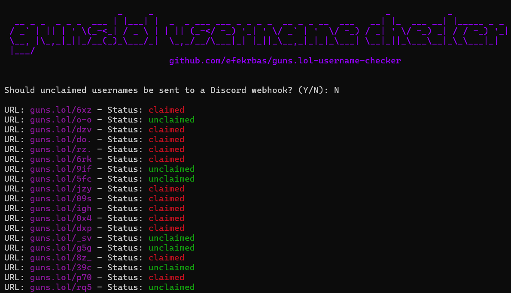

#  guns.lol Username Checker


A powerful, high-accuracy CLI tool that checks username availability on **guns.lol, haunt.gg, jugs.lol and any other bio-link site** using Selenium, with a selectable main menu, 8 intro animations, 6 colour themes, per-site Discord webhooks and a built-in username list generator.

## ⚠️ Important Note
- On **guns.lol**, usernames that start or end with characters such as ".", "-", or "_" are **Premium Aliases**. You need a premium account to claim these. The filter only applies to sites that have that rule (not to haunt.gg or jugs.lol), so one run can correctly report `/name.` as premium-only on guns.lol and available elsewhere.
- The tool checks publicly visible profile pages. It never logs in, claims names or sends anything except the Discord webhooks you choose.

### 🌐 Free Proxies (Webshare.io)
> You can get **10 free permanent HTTP proxies** per account from [Webshare.io](https://www.webshare.io/). Simply create a free account, copy your proxy credentials, and paste them into `proxies.txt`, one per line. Supported formats: `host:port:username:password`, `username:password@host:port` and `host:port`.

### 📌 Known Issues
> **Occasional Error / Timeout:** a username can still very rarely show `error/timeout` during a Cloudflare challenge spike, when a site blocks your IP (haunt.gg is strict) or on a slow network. The checker waits longer for challenges, rotates proxies on failures and, in custom-list mode, automatically retries those usernames once at the end of the run.

### 🧹 Chrome Auto-Cleanup
> When the tool finishes or is closed (including via `Ctrl+C` or by closing the window), **the Chrome and chromedriver processes it started are automatically terminated**. No background Chrome processes are left running, and other Chrome/Selenium programs on your PC are never touched.

## 🎬 Main menu
After the intro animation you get a selectable screen instead of a wall of questions:

```
  ============== MAIN MENU ==============
   [1] Start checking
   [2] Start with saved settings (3 sites, auto delay)
   [3] Settings
   [4] Webhook manager (2 saved)
   [5] List generator for customlist.txt
   [6] Help / About
   [0] Exit
```
`[2]` runs immediately from `settings.json` (saved automatically after every run), so a repeat session is one key press. Piped input still skips the menu and behaves like the classic script.

## ⭐ Features
- **Main menu & settings screen:** everything is configurable from the CLI — intro animation, colour theme, default sites, length, delay, premium filter, saving hits and proxies — and it is remembered in `settings.json`.
- **8 intro animations:** Fade, Gradient wave, Rainbow sweep, Pulse, Typewriter, Slide in, Matrix decode or none (with a preview before you commit).
- **6 deeper CLI themes:** Royal Purple, Deep Ocean, Forest Mint, Burnt Ember, Wine Rose and Charcoal.
- **List generator:** fill `customlist.txt` from 22 patterns and bundled word lists (see below), with preview, size warnings and replace/append/new-file output.
- **Speed engine:** an HTTP fast path (no browser) plus a per-site adaptive pacer and a bounded rate benchmark. See below.
- **Multi-site checking:** guns.lol, haunt.gg and jugs.lol are built in. Select several with `1,2,3` and every username is checked on each of them.
- **Any bio-link site:** add your own provider to `sites.json` with a `{username}` URL and optional "not found" phrases — no code changes.
- **Per-site Discord webhooks:** store any number of webhooks in `webhooks.txt` and route each one to the sites it should hear about — one channel for jugs.lol hits, another for everything else, or one per site. Add / re-route / remove / test from the menu. Tokens are masked on screen.
- **Premium purple CLI Theme:** Stylish, modern purple interface using `pystyle`.
- **Intro Animations:** Smooth, flicker-free fade-in and a persistent header that keeps your answered settings on screen.
- **Accurate Detection:** HTTP status + visible headings, with body-text checks only where safe. Waits out challenges, backs off on rate limits and never reports an inconclusive page as "claimed".
- **Custom Lists:** Comments, duplicates, full `guns.lol/` links and invalid entries in `customlist.txt` are handled automatically.
- **Smart Random Mode:** Never checks the same username twice per session and stops once every combination of a short length is done.
- **Authenticated Proxies:** Rotate HTTP proxies from `proxies.txt` between every request with automatic fail-over. Works on current Chrome versions (no extension needed).
- **Self-Healing:** Chrome is relaunched automatically if it crashes during a long run.
- **Live Stats:** Checked / unclaimed / error counters in the window title and a per-site summary when the run ends.

## 🌍 Supported sites

| Site | Availability rule | Premium aliases |
| --- | --- | --- |
| guns.lol | visible "Username not found" heading or 404 | yes (`.`, `-`, `_` at either end) |
| haunt.gg | HTTP 404 / not-found title or heading (body text ignored — its Discord widget literally says "Not Found") | no |
| jugs.lol | HTTP 404 and the title `Not found \| jugs.lol` | no |
| your site | set the URL + `not_found` phrases in `sites.json` | optional |

### Adding any bio-link site
Create or edit `sites.json` next to `gunslol.py`:

```json
{
  "sites": [
    {
      "name": "bio.site",
      "url": "https://bio.site/{username}",
      "not_found": ["page not found", "profile not found"],
      "premium": false,
      "check_body": false,
      "note": "my extra site"
    }
  ]
}
```

- `url` **must** contain `{username}`; `https://…` or `http://…`.
- `not_found` phrases are matched (case-insensitively) against the page title and visible headings while the HTTP status is not decisive.
- `check_body` scans the whole visible page too — only enable it if that phrase can never appear on a real profile (widgets often contain generic "Not Found").
- `enabled: false` keeps an entry without using it. An entry with the same `name` as a built-in overrides it.
- `status_not_found` overrides the default `[404, 410]`.

Loaded providers are numbered when you run the script; answer e.g. `1,3` or `A` for all.

## 💾 Saved webhooks & routing
Open the menu → **Webhook manager** → **1) add**, give it a name and choose the sites it should receive. Run-flow only asks *which* saved webhooks to use (`1,3` / `A` / `N`); adding, re-routing and testing live in the manager.

```
   [*] 1) Jugs hits     discord.com/api/webhooks/1234…/abcd…  -> jugs.lol
   [*] 2) Everything    discord.com/api/webhooks/9876…/efgh…  -> all sites
```

- A jugs.lol hit is delivered to the jugs.lol channel (plus any "all sites" channel) and never to unrelated ones. The summary shows how many notifications each channel received and how many were routed away.
- `webhooks.txt` format: `Name | https://discord.com/api/webhooks/... | site1,site2` — the third field is optional (missing = all sites). On Linux/macOS it is created with `chmod 600`, and it is gitignored because it holds secrets.
- Webhooks are verified with Discord when you add them, tested from the manager, and dropped automatically if Discord reports them deleted.

## 🎛️ Settings
| Option | Effect |
| --- | --- |
| Intro animation | 8 styles, previewed before you commit; `none` skips animation entirely |
| Colour theme | 6 accent palettes for the whole CLI |
| Default sites | Pre-selected on every run |
| Random name length | 1-32 characters |
| Delay | Seconds between requests (0 = automatic jitter) |
| Premium filter | Skip guns.lol aliases that need premium |
| Save hits | Write `unclaimed.txt` |
| Use proxies | Rotate `proxies.txt` (validated right away) |
| Webhook manager | Add, re-route, remove and test webhooks |

Everything is stored in `settings.json` (created automatically, written atomically, invalid values fall back to defaults).

## ⚡ Speed & rate limits
Two independent things make runs faster without hammering a site:

**1. HTTP fast path (`speed.py`).** guns.lol and jugs.lol render their verdict server-side, so they are checked with plain HTTP requests (cookies handled automatically). Chrome is only launched for sites that need JavaScript (haunt.gg) — and if every selected site is HTTP-capable, **no browser is launched at all**.

Measured in the test-suite (mock site with a 12 requests/second limit): 40/40 names answered over HTTP, 0 browser launches, 0 errors, 4.8 names/second on adaptive pacing. Live probes against guns.lol already confirm the same verdicts as Chrome, including the profile-widget trap (`efe` is claimed, not "User Not found"). Chrome rendering previously took ~2.5–3 s per name per site plus a 5–10 s browser start.

**2. Adaptive pacing.** One `Pacer` per site:
- a clean answer slowly closes the gap (down to the mode's floor);
- a 429, challenge or block doubles the gap for that site and remembers where it happened;
- a 429 is reported as `error/timeout` and **never retried in Chrome** (same wall, more traffic);
- all selected sites are checked in parallel (1–6 requests in flight depending on mode).

### Speed modes
| Mode | Starting gap | Minimum | Parallel requests |
| --- | --- | --- | --- |
| Steady | 0.90 s | 0.45 s | 1 |
| Fast | 0.35 s | 0.12 s | 3 |
| Turbo | 0.12 s | 0.04 s | 6 |
| Adaptive (default) | 0.30 s | 0.06 s | 4 |

Set it in **Settings ▸ Speed mode**, or pass your own delay in the run flow (it becomes the minimum gap).

### Rate benchmark (polite)
**Main menu ▸ Rate benchmark.** It is deliberately bounded: at most 8 requests, starts at a 0.8 s gap and shortens it by 25% per clean answer. It stops at the **first** 429 / block / error, never retries, and recommends a pace with a 1.6× safety margin. It measures a starting point for your IP or proxy; the adaptive pacer then keeps adjusting during the real run. It is not a stress test and will not try to find an exact breaking point.

## 🧾 List generator
Menu → **List generator**. Pick a pattern, preview it, then replace / append / write to a new file. `//`-comment headers are added so `customlist.txt` stays readable.

| Group | Patterns |
| --- | --- |
| Combination | 2C, 3C (all 2 / 3-character names), aliases **All 2Cs**, **All 3Cs** |
| Letters only | 2L, 3L, 4L |
| Numbers only | 2N, 3N, 4N |
| Styled | Semi 3Ls (`a_bc`), Dotted words (`s.e.a`), `_ Repeaters`, Faces (`X_X`, `X.X`) |
| Word lists | TOP 10K English Words, Cities in the world, E-Girl Names, E-Boy Names |
| Advanced | Pronounceable 4Ls, Letter Repeaters, 4L Repeaters 10K, Leet 4Cs |

- Sizes are shown before writing; a 4L list is 456,976 lines, so the tool warns and can write it to a separate `.txt` instead of `customlist.txt`.
- Optional premium filter drops names starting/ending with `.`, `-`, `_` for guns.lol runs.
- Word lists are editable text files in `./data` (`words_top.txt` = 9,820 common words, `cities.txt` = 721 world cities, `egirls.txt`, `eboys.txt`). Add your own lines and they are picked up immediately.
- Everything is generated offline and deterministically, so the same pattern always yields the same list.

## 🛠️ Installation

1. **Prerequisites:** Ensure you have [Python 3.8+](https://www.python.org/) and Google Chrome installed.
2. **Clone & Setup:**
   ```bash
   git clone https://github.com/efekrbas/guns.lol-username-checker.git
   cd guns.lol-username-checker
   ```
3. **Install Requirements:**
   ```bash
   pip install -r requirements.txt
   ```
   *Or just run `install.bat` on Windows, or `chmod +x install.sh && ./install.sh` on Linux/macOS.*

## 🚀 How to Use

Run the script (or double-click `gunslol.py` on Windows):
```bash
python gunslol.py
```

### Prompt Flow
0. **Press Enter** — Intro animation plays, then the main menu appears.
1. **Sites** — `1,2` for specific providers, `A` / Enter for all, including `sites.json` entries.
2. **Use customlist.txt?** — Load your own list of usernames (one per line).
3. **Username length** — Char count for random generation (only asked in random mode).
4. **Delay (Interval)** — Seconds between requests (Recommended: 0 = automatic jitter).
5. **Use proxies.txt?** — Rotate through proxies between requests. If the file has a problem, the error is shown and you can fix it and answer again.
6. **Filter Premium?** — Auto-skip names free users can't claim. Asked only when a site with premium aliases is selected.
7. **Save to unclaimed.txt?** — Log hits to a file (no duplicates).
8. **Discord webhooks** — Pick saved webhooks by number and/or add new ones; answer `N` to skip.

Answers accept `Y`/`N` as well as `yes`/`no`. Press `Ctrl+C` at any time to stop — a summary is printed and Chrome is closed. All files (`customlist.txt`, `proxies.txt`, `sites.json`, `settings.json`, `webhooks.txt`, `unclaimed.txt`) live next to `gunslol.py`, wherever you start it from.

### Output
```
  16:13:07  #0001  guns.lol/efe [-] claimed  ·  haunt.gg/efe [+] unclaimed  ·  jugs.lol/efe [+] unclaimed
```
| Status | Meaning |
| --- | --- |
| `[+] unclaimed` | Free on that site — saved and/or sent to every selected webhook |
| `[-] claimed` | The profile exists on that site |
| `[!] error/timeout` | No reliable answer after 3 attempts (retried once at the end in custom-list mode) |
| `[~] skipped` | Premium alias filtered out on a site that requires premium |

When more than one site is selected, `unclaimed.txt` stores `site.tld/username` so hits stay unambiguous. With a single site the lines stay bare usernames, like v1.

All files (`customlist.txt`, `proxies.txt`, `sites.json`, `webhooks.txt`, `unclaimed.txt`) are read from / written to the folder that contains `gunslol.py`, wherever you start it from.

## 🧯 Troubleshooting
- **"Error launching Chrome"** — install or update Google Chrome. On the very first run Selenium downloads a matching ChromeDriver, so an internet connection is required.
- **`install.sh` says the environment is externally managed** — the script then creates a `.venv` automatically; start the checker with `.venv/bin/python gunslol.py`.
- **Many errors on haunt.gg** — the site uses a strict WAF and may block your IP; use proxies or check it together with the other sites.
- **A custom site reports everything as claimed** — its missing profiles probably answer `200`. Add the exact phrase a missing profile shows to that site's `not_found` list (and `check_body: true` only if it never appears on real profiles).
- **Proxies show many errors** — check the credentials in `proxies.txt`. Proxies that refuse authentication or are offline are benched for 60 seconds automatically, and the summary shows how many are still healthy.

## 🧪 Tests
An offline test-suite (no Chrome or internet needed) covers detection (including the haunt.gg widget trap and jugs.lol's 404 page), retries, multi-site runs, the HTTP fast path, the pacer and rate benchmark, all 8 intro animations, saved webhooks with routing, proxy forwarding / rotation / fail-over, file handling, the list generator and prompts:
```bash
python -m unittest discover -s tests -v
```

## 📝 Changelog

### v2.3.0
- **Speed:** added `speed.py` with an HTTP fast path (guns.lol, jugs.lol), lazy browser launch, parallel site checks, a per-site adaptive pacer and four speed modes. A 429 is no longer escalated to Chrome.
- **Rate benchmark:** added a bounded, abort-on-first-pushback pace measurement with a 1.6× safety margin and actionable advice.
- **Intro fix:** the v2.2 painters printed raw `"r;g;b"` triples instead of ANSI escapes and never cleared shorter frames. The renderer now writes proper truecolour escapes, pads every frame to a fixed height, clears to end-of-screen, restores the cursor and survives stdin without a fileno. Verified for all 8 animations at 30×10, 40×14 and 200×60.
- **Deeper palette:** all six CLI themes were re-tuned to deep accents with quieter secondary tones (Royal Purple, Deep Ocean, Forest Mint, Burnt Ember, Wine Rose, Charcoal).
- Stats now split HTTP vs browser checks, and the summary reports each site's counts.
- 70 offline tests (was 61).

### v2.2.0
- **Added a selectable main menu** after the intro: start, start with saved settings, Settings, Webhook manager, List generator, Help or Exit.
- **Added Settings** (persisted in `settings.json`): intro animation, CLI colour theme, default sites, random length, delay, premium filter, saving hits and proxies — all editable from the CLI and remembered between runs.
- **Added 8 intro animations** (fade, gradient wave, rainbow sweep, pulse, typewriter, slide, matrix decode, none) with previews, replacing the single fade.
- **Added 6 CLI colour themes** that recolour the whole interface.
- **Added a list generator** with 22 patterns and bundled word lists (top 10k English words, 721 world cities, e-girl/e-boy name lists) to fill `customlist.txt`, with preview, size warnings and replace/append/new-file modes.
- **Webhook routing per site:** each saved webhook can be dedicated to specific sites, so a jugs.lol hit lands in the jugs.lol channel. The manager (now in Settings) can add, re-route, remove and test webhooks.
- Moved the webhook manager out of the run flow into Settings; the run flow now only selects saved webhooks.
- `generator.py` added; `data/` ships the word lists. `webhooks.txt` gained an optional third field for routing (backwards compatible).

### v2.1.0
- **Added multi-site checking:** guns.lol, haunt.gg and jugs.lol built in; select several sites per run, with per-site verdicts, per-site premium rules and per-site stats.
- **Added `sites.json`:** support any bio-link provider with a `{username}` URL template and configurable not-found phrases; built-ins can be overridden.
- **Added saved webhooks (`webhooks.txt`):** save any number of Discord webhooks, select them by number on later runs, choose multiple, fan out hits to all of them and manage (add / remove / test) inside the CLI. Webhook tokens are masked on screen and the file is gitignored + `chmod 600` on POSIX.
- Availability detection now prefers the navigation HTTP status and only scans body text for sites that opt in. This avoids haunt.gg's false "Not Found" widget text while correctly using jugs.lol's 404 page.
- Retried verifications no longer inflate the error count; the summary shows unique usernames plus total site checks and a per-site breakdown.

### v2.0.0
**Fixed**
- Proxies stopped working on Chrome 137+ because Chrome no longer loads extensions passed with `--load-extension`. Proxies now go through a built-in local forwarder (standard library only) with authentication, per-username rotation and fail-over.
- Pages that were still showing a challenge or rate-limit screen after every retry were reported as **claimed**. They are now reported as `error/timeout`.
- Cloudflare "Just a moment..." / block pages were treated as loaded profiles (false "claimed").
- Prompt error messages were wiped instantly by the screen refresh, so they were never visible.
- Closing stdin (Ctrl+Z / Ctrl+D or piped input) made the prompt loop forever.
- Messages such as "N usernames loaded from customlist.txt" disappeared immediately.
- Pressing Ctrl+C during the intro left the program hanging until Enter was pressed, and could leave the cursor hidden.
- The intro "fade" used 24 copies of the same colour and cleared the screen every frame (flicker without a fade).
- On exit, `taskkill /IM chromedriver.exe` killed **every** chromedriver on the PC. Now only this run's process tree is terminated.
- The "Press any key to exit" pause did not trigger with the default `py.exe` file association.
- The Windows console handler used a 1-byte `c_bool` return type for a 4-byte `BOOL`.
- `customlist.txt` / `proxies.txt` were only found when the script was started from its own folder; Notepad UTF-8 BOM / UTF-16 files were not read correctly.
- Entering `inf` as delay crashed the checker.
- Webhook messages were silently lost on Discord rate limits.
- The fixed Chrome 120–122 user-agent did not match the real browser's client hints.

**Improved**
- Prompt flow asks for the username length only in random mode.
- Custom lists: duplicates removed, `guns.lol/` links accepted, invalid names reported instead of producing false hits, errored names retried once.
- Random mode never repeats a username within a session.
- Automatic Chrome restart after crashes; webhooks sent in the background; live stats in the title; summary at the end.
- Ships with an offline test-suite.

## 📷 Preview

<p align="left">
  
</p>

## 🙏 Acknowledgements
  - [@noivan0](https://github.com/noivan0) — Thanks for the filtering feature contributions and readme shield badges suggestion.

## 📜 License
This project is licensed under the MIT License - see the [LICENSE](LICENSE) file for details.
